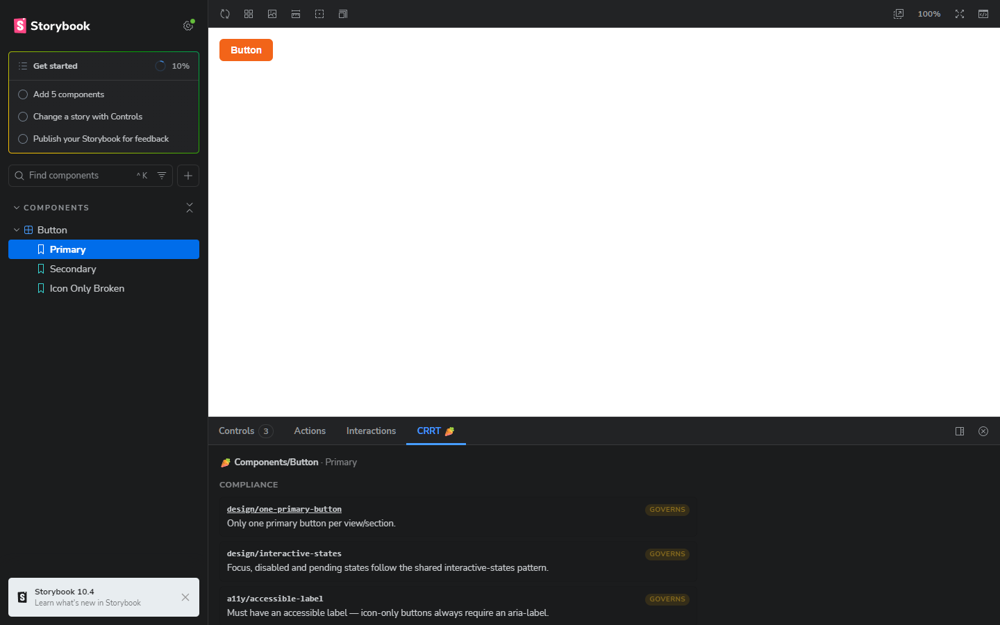
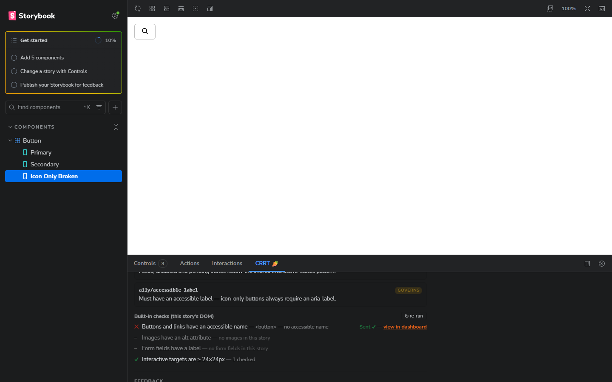
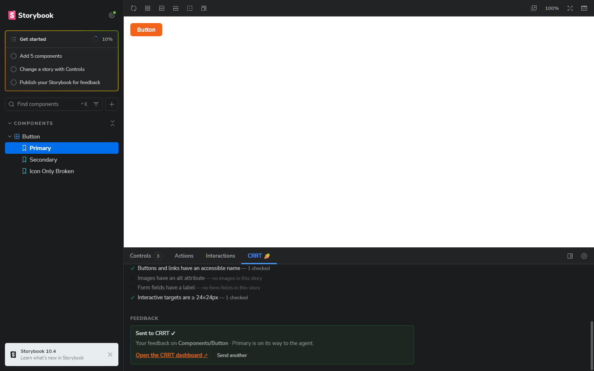

# @thedesignproject/crrt-storybook

CRRT 🥕 inside Storybook — a native addon panel where stakeholders leave feedback on the exact component and story they're viewing, and see the rules that govern it first.

> **The interaction philosophy:** the panel talks to stakeholders FROM the rules — it educates, it doesn't just collect. A stakeholder opens Button and sees what governs it before they ask for anything.

And failed checks are one click away from being fixed — the panel doesn't just report issues, it dispatches them.

No selectors, no clicking on elements, no floating widget: the story IS the context. The panel reads the active story's identity straight from Storybook's API and attaches it to every comment, so the agent on the other end knows exactly what's being discussed.



## What the panel shows

**1. Compliance — the proactive layer, first.** When a story is active:

- The **rules governing this component**, as readable cards: rule id, its one-line essence, and status. In v1 status is informational (`governs`) — the panel displays governance, it doesn't yet compute pass/fail against the DOM (that's v2).
- A **built-in checklist** computed against the story's real DOM in the preview iframe:
  - Buttons and links have an accessible name
  - Images have an `alt` attribute
  - Form fields have a label
  - Interactive targets are ≥ 24×24px (WCAG 2.2 minimum)

  Honesty contract: a check only reports pass/fail when it actually inspected matching elements — no matching elements shows as *n/a* with the reason, and an unreachable preview reports itself instead of pretending. No fake green checkmarks.

  **Failed checks are dispatchable.** Every ✕ row gets its own small **Send to CRRT** button. One click auto-composes a structured issue — no typing — and posts it through the same client as regular feedback:

  ```
  [compliance issue] Buttons and links have an accessible name — check failed
  Checks: every button and link exposes a name to assistive technology
  Story: Components/Button · Icon Only Broken
  Element: <button> — no accessible name
  Governed by: a11y/accessible-label
  Suggested: needs an accessible name — aria-label or visible text
  ```

  The `Governed by` line appears only when the check genuinely maps to one of the story's declared rules (matched by rule id — no forced mappings), and the suggestion is derived from the check's nature, not speculation. After sending, the row shows an inline *Sent ✓ — view in dashboard*; each failed check dispatches independently, and a check already sent for the same story this session is disabled (*Already sent*) to avoid duplicates. Passed and n/a checks get no button — only failures are actionable.

  

**2. Feedback — the collect layer.** A textarea, an optional name, and a **Send to CRRT** button. On send, the comment posts to the hosted CRRT API with the story's metadata attached, then shows a sent state with a link to the CRRT dashboard.

## Connect from CRRT Pro

Storybook is a CRRT Pro integration. Open the project in CRRT, choose
**Storybook** in the existing setup card, and copy the generated command:

```sh
npx @thedesignproject/crrt-storybook connect --code <one-time-code>
```

The command validates the short-lived code, detects the project's package
manager and Storybook configuration, registers the addon with Storybook's
official installer, and writes non-secret connection metadata to
`.storybook/crrt.json`. The code is never stored. Return to the same CRRT
project card to see **Storybook connected**.

To diagnose an existing connection without changing files:

```sh
npx @thedesignproject/crrt-storybook doctor
```

No separate CRRT account, product, or setup page is created.

## Sign in for private feedback

The connected panel opens the existing CRRT login in a popup. After sign-in,
CRRT exchanges a one-time PKCE handoff for a project, connection, and origin
scoped token. The addon holds it only in memory for this manager page; refreshing
Storybook requires signing in again. Requests use a bearer token with cookies
omitted. Account tokens never enter Storybook config, URLs, or the build.

The panel handles expired sessions and revoked access without falling back to
public ingestion. Guests may leave feedback when project permissions permit it,
even when they cannot operate Agent. Connected feedback uses the signed-in name;
the optional author field remains available for manual public configurations.

For the local integration demo, open `http://127.0.0.1:6007/`, select a story and
choose the **CRRT** panel. The local dashboard is on port 4328 under `/dashboard/`
and the API is on port 3193. `.storybook/crrt.json` contains public local connection
metadata and is ignored by Git; keep account/session credentials out of it.

## Manual development setup

The connected CRRT Pro flow above is the supported customer path. Addon
contributors can still register the package manually:

```ts
const config: StorybookConfig = {
  addons: ["@thedesignproject/crrt-storybook"],
  // ...
};
```

## Configure governance rules

Governance rules remain normal Storybook parameters, so they can live next to
the component they describe. Manual public-project development can also set a
project key in `.storybook/preview.ts`:

```ts
const preview: Preview = {
  parameters: {
    crrt: {
      projectId: "your-public-crrt-project-key", // manual development only
      // apiBase: "https://crrt.ai/api",  // default
      // dashboardUrl: "https://crrt.ai", // where the sent-state link points
      // checks: false,                   // disable the built-in DOM checks
    },
  },
};
```

Rules are usually declared per component, in the story file's meta — mirroring the design system's `*.meta.yaml` (rule id + one-line essence):

```ts
const meta = {
  title: "Components/Button",
  component: Button,
  parameters: {
    crrt: {
      rules: [
        {
          id: "design/one-primary-button",
          essence: "Only one primary button per view/section.",
          href: "https://github.com/your-org/your-ds/blob/main/brain/design/components/button.md",
        },
        {
          id: "business/auth-access",
          essence: "Failed login shows one generic message.",
        },
      ],
    },
  },
} satisfies Meta<typeof Button>;
```

Parameters merge the Storybook way: global → component → story, so a single story can override or extend its component's rules.

## What gets sent to CRRT

Connected CRRT Pro projects submit through the authenticated Storybook
connection endpoint. The addon verifies the signed-in user's project access
and never falls back to the public endpoint when private verification fails.

The manual parameter-only development mode continues to use
`POST {apiBase}/v1/public/comments`. In both modes, story metadata uses the
existing feedback fields:

| CRRT field | What the addon puts there |
|---|---|
| `projectKey` | `parameters.crrt.projectId` |
| `pageUrl` | Deep link back to the story (`…/?path=/story/<storyId>`) |
| `selector` | `storybook://<storyId>` — machine-parseable story identity |
| `body` | The feedback text + a footer: `— via Storybook · component: Components/Button · story: Primary · id: components-button--primary` |
| `x`, `y` | `50, 50` (required by the API; a panel has no click point) |
| `authorName` | The optional name field (persisted in localStorage) |

## The flow (GIF-able)

1. A stakeholder opens the **Button → Primary** story and clicks the **CRRT 🥕** tab.
2. Before typing anything, they see the Compliance section: *"design/one-primary-button — Only one primary button per view/section"*, plus live checks on the rendered story.
3. They type *"Make the primary button a bit more prominent…"* and hit the orange **Send to CRRT**.
4. The panel flips to *Sent to CRRT ✓* with a link to the dashboard — where the comment arrives already tagged with the component, story and variant.
5. They switch to **Icon Only Broken**: the accessible-name check shows a red ✕ — one click on the row's **Send to CRRT** and the structured issue (element, governing rule, suggested direction) is dispatched too.



## Development

This package contains a minimal example Storybook (one Button, three stories — one of which deliberately fails the accessible-name check):

```sh
npm install
npm run storybook   # example Storybook on http://localhost:6007
npm run build       # bundle the addon with tsup
npm test            # CLI, connection, and preset contract tests
npm run pack:verify # inspect the exact npm package contents
npm run consumer:verify # install the tarball in a clean Storybook and build it
```

The example loads the same built ESM preset that ships to consumers, rather
than registering a second development-only panel.

## Compatibility

- Node 20.19 or newer.
- Storybook 10 with React; CI verifies the React + Vite path.
- npm, pnpm, Yarn, and Bun project detection.

We do not claim Storybook 9 or non-React compatibility until those paths have
their own fixture coverage.

## Roadmap

- **v2 — computed compliance:** evaluate rule pass/fail against the rendered DOM instead of informational cards; pull rules from the design system's `*.meta.yaml`/CRRT API instead of parameters.
